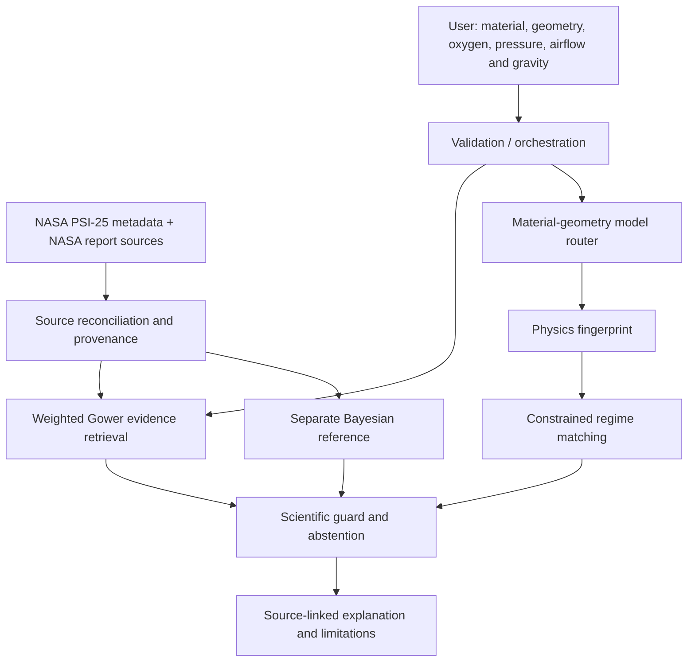

# EMBER — Explainable Microgravity Burn Evidence & Regime Bridging

**NASA Space Apps Challenge 2026 · Flame in Freefall · One Man Orbit**

[](docs/data-provenance.md)
[](docs/algorithms.md)
[](docs/source-snapshots.md)

**[Launch the live EMBER platform](https://ember-mvp-one-man-orbit.vercel.app/)** · **[Watch the video demo](https://www.youtube.com/watch?v=ClBB6BDd4AQ)** · **[User manual (PDF)](https://drive.google.com/file/d/1LP464j96IjfntalNycTRG_JweqMJsy6k/view?usp=drive_link)** · **[Architecture](docs/architecture.md)** · **[Mathematical methods](docs/algorithms.md)** · **[Interactive explainer](docs/index.html)**

EMBER connects source-linked NASA microgravity combustion experiments to bounded, material-specific physics calculations and explicit scientific abstention. Experimental evidence, computational fingerprints, and protocol-specific statistical estimates are reported separately rather than presented as interchangeable forms of proof.

> **Scope and source-status disclosure:** The latest Vercel production source is **not fully mirrored** in this repository. The original complete **GitHub-ready archival package** was prepared separately; the material published here includes verified project documentation, original-method extracts, an independent educational demonstration and source snapshot guidance. See [Source provenance](docs/source-snapshots.md). GitHub publishing has not modified the Vercel application.

## Project demo and user manual

[](https://www.youtube.com/watch?v=ClBB6BDd4AQ)

- **[Watch the EMBER video demonstration on YouTube](https://www.youtube.com/watch?v=ClBB6BDd4AQ)** — hosted on YouTube and linked here for easy access.
- **[Read the EMBER user manual (Google Drive PDF)](https://drive.google.com/file/d/1LP464j96IjfntalNycTRG_JweqMJsy6k/view?usp=drive_link)** — instructions and walkthrough for using the live application.

## Scientific modules

| Module | Purpose | Scientific boundary |
| --- | --- | --- |
| NASA Evidence Explorer | Ranked source-linked experimental conditions using weighted Gower-style mixed-type similarity | Similarity is not ignition probability, nor full physical equivalence |
| Physics model router | Select material- and geometry-specific published correlations | No single equation validates combustion for all materials or gravities |
| Constrained regime comparison | Compare selected physical fingerprints under explicit domain constraints | Matching a fingerprint is not matching an entire flame |
| Bayesian ignition reference | Model sustained-ignition outcomes under a defined PMMA/ISS protocol | 19 observations (16 positive / 3 negative); no external cross-gravity generalization demonstrated |
| Scientific guard | Preserve out-of-domain and unsupported-bridge states | Abstains where evidence or applicability is insufficient |

## Explore the repository

- [Formal system architecture](docs/architecture.md) — layered engineering block diagram and request lifecycle
- [Mathematical methodology](docs/algorithms.md) — Gower, kNN-style retrieval, Bayesian inference, metrics, physics, inverse matching
- [NASA data provenance](docs/data-provenance.md) — source counts, nonadditive records, source and outcome distinctions
- [Source-package disclosure](docs/source-snapshots.md) — archived code versus current deployment
- [Interactive explainer](docs/index.html) — client-side walkthrough and synthetic Gower demonstration
- [Standalone retrieval example](examples/gower_demo.py) — source-derived educational implementation, not the current production service
- [Regression checks](tests/test_gower_demo.py) — mathematical and edge-case tests

<details><summary><b>System architecture preview</b></summary>


</details>

## Quick demonstration

Python 3.10+ is sufficient for the independently runnable example (no third-party dependencies):

```bash
python examples/gower_demo.py
python -m unittest discover -s tests -v
```

The example uses **synthetic records**, not the NASA database; it demonstrates similarity ranking without asserting any flame outcome. It is not the deployed FastAPI application. The complete archived research-core ZIP prepared earlier is a separate deliverable until its full source is uploaded to the repository.

## Scientific caution

EMBER is a research and evidence-navigation prototype, **not** a certified spacecraft fire-safety system. Do not interpret these calculations as independent experimental validation, general ignition predictors, or official NASA endorsement. Preserve exact source identifiers, data missingness and the distinction between observed measurements and calculated estimates.

## Primary NASA sources

- [NASA Physical Sciences Informatics — BASS-II PSI-25](https://psi.nasa.gov/physci/repo/data/investigations/PSI-25)
- [BASS-II technical report, NASA/TM-20210011385](https://ntrs.nasa.gov/citations/20210011385)

## Rights and contributions

Project: **One Man Orbit**. Preserve third-party authorship and scientific attribution. No license for every recovered source package or dataset is implied by public visibility. See [NOTICE](NOTICE.md), [Contributing](CONTRIBUTING.md) and [Security](SECURITY.md).
