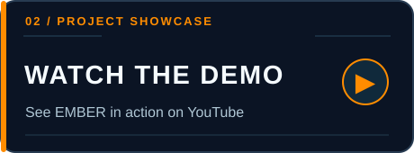
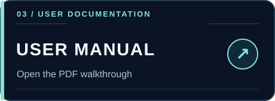
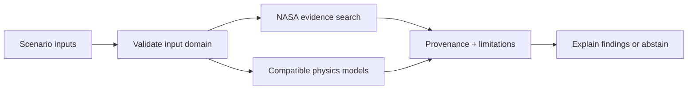
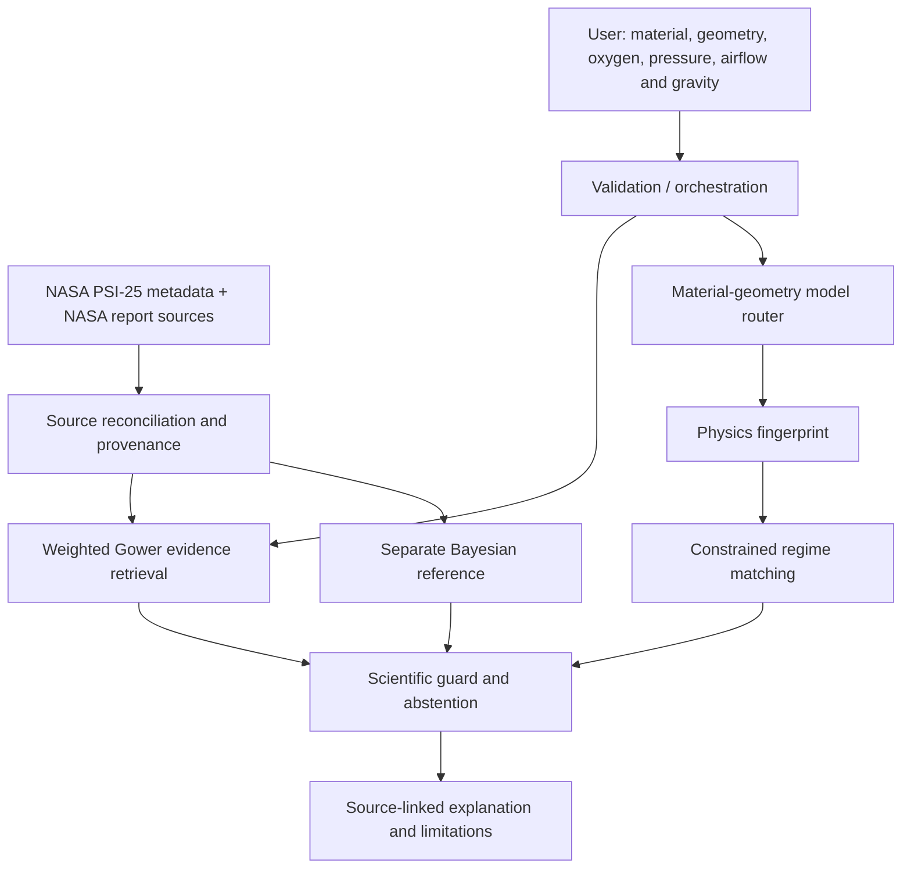

<div align="center">

<a href="https://ember-mvp-one-man-orbit.vercel.app/">
  
</a>

### EXPLAINABLE MICROGRAVITY BURN EVIDENCE & REGIME BRIDGING

**NASA Space Apps Challenge 2026** · **Flame in Freefall** · **One Man Orbit**

[](docs/data-provenance.md)
[](docs/algorithms.md)
[](docs/source-snapshots.md)

</div>

---

## Mission control — start here

**Choose a destination.** These cards are clickable and lead directly to the live project, the video demonstration, and the user manual.

<table>
<tr>
<td align="center" width="33%"><a href="https://ember-mvp-one-man-orbit.vercel.app/"></a></td>
<td align="center" width="33%"><a href="https://www.youtube.com/watch?v=ClBB6BDd4AQ"></a></td>
<td align="center" width="33%"><a href="https://drive.google.com/file/d/1LP464j96IjfntalNycTRG_JweqMJsy6k/view?usp=drive_link"></a></td>
</tr>
</table>

<div align="center">

**[Architecture](docs/architecture.md)** · **[Mathematical models](docs/algorithms.md)** · **[NASA data provenance](docs/data-provenance.md)** · **[Interactive scientific explainer](docs/index.html)**

</div>

> [!IMPORTANT]
> **Research prototype and source status.** EMBER is not a certified spacecraft fire-safety system or an official NASA product. The GitHub repository **does not fully mirror** the latest Vercel production source. The published materials contain scientific documentation, selected code extracts and an independent educational demonstration. See [source provenance and snapshot limitations](docs/source-snapshots.md).

## What is EMBER?

**EMBER turns fragmented microgravity combustion research into traceable scientific context.** Instead of treating a model estimate as experimental proof, it keeps source-linked NASA evidence, physics-based calculations and protocol-specific probability estimates distinct. Unsupported cases are marked with explicit scientific limitations or abstention.

### From scenario to evidence



## Scientific capability map

| Component | What it does | Scientific boundary |
| :-- | :-- | :-- |
| **01 · NASA Evidence Explorer** | Retrieves source-linked experimental conditions with weighted Gower-style mixed-type similarity | Similarity is not ignition probability or physical equivalence |
| **02 · Material / geometry model router** | Selects published, applicable physics correlations | No single correlation represents every material and gravity regime |
| **03 · Regime comparison** | Evaluates bounded physical fingerprints under domain constraints | Shared fingerprints do not prove flame equivalence |
| **04 · Bayesian ignition reference** | Reports evidence from a specified PMMA/ISS protocol | Only 19 observations (16 positive / 3 negative); not a validated universal prediction |
| **05 · Scientific guard** | Marks unsupported and out-of-domain results | Abstention is preferable to false numerical precision |

## Watch the project demonstration

<div align="center">

<a href="https://www.youtube.com/watch?v=ClBB6BDd4AQ">
  
</a>

**[▶ PLAY EMBER DEMO ON YOUTUBE](https://www.youtube.com/watch?v=ClBB6BDd4AQ)**

</div>

## Technical documentation

| Resource | Contents |
| :-- | :-- |
| 🛰️ [System architecture](docs/architecture.md) | Layered system layout and analysis request lifecycle |
| 📐 [Mathematical methodology](docs/algorithms.md) | Gower / kNN-style retrieval, Bayesian inference, physical fingerprinting and inverse matching |
| 🔬 [NASA BASS-II data provenance](docs/data-provenance.md) | Official source entry points, record reconciliation and measured-versus-derived distinctions |
| 🧭 [Interactive explainer](docs/index.html) | Interactive educational demonstration of the retrieval approach |
| 🧾 [Source archive disclosure](docs/source-snapshots.md) | What source is archived here and what is not identical to production |
| 🧪 [Standalone Gower example](examples/gower_demo.py) | Independently runnable example using synthetic, not NASA, records |
| ✅ [Regression tests](tests/test_gower_demo.py) | Example-level numerical and edge-case checks |
| 📘 [Full PDF user manual](https://drive.google.com/file/d/1LP464j96IjfntalNycTRG_JweqMJsy6k/view?usp=drive_link) | Walkthrough of the deployed platform |

<details>
<summary><b>🧩 Expand the formal system architecture</b></summary>




</details>

<details>
<summary><b>💻 Expand local educational demo instructions</b></summary>

Python 3.10+ can run the independent dependency-free retrieval example:

```bash
python examples/gower_demo.py
python -m unittest discover -s tests -v
```

This uses **synthetic records**, not the NASA database. It demonstrates similarity ranking without asserting any experimental flame outcome and **is not** the deployed FastAPI application. The archived research-core package is distinct from the latest live Vercel source.

</details>

<details>
<summary><b>📚 Expand NASA primary sources</b></summary>

- [NASA Physical Sciences Informatics — BASS-II / PSI-25](https://psi.nasa.gov/physci/repo/data/investigations/PSI-25)
- [BASS-II technical report, NASA/TM-20210011385](https://ntrs.nasa.gov/citations/20210011385)

Experimental observation, similarity retrieval and physics-derived estimates remain distinct evidence classes.

</details>

## Research integrity

EMBER is a research and evidence-navigation prototype — **not a flight-qualified safety decision system**. It does not claim NASA endorsement, external model certification, universal flame equivalence or validation beyond the stated material/geometry/protocol domains.

## Project and credits

**Team:** One Man Orbit · **Event:** NASA Space Apps Challenge 2026, *Flame in Freefall*.

Please preserve third-party research authorship and dataset attributions. Repository visibility does not imply a license to redistribute every archived source package or NASA dataset. See [NOTICE](NOTICE.md), [Contributing](CONTRIBUTING.md) and [Security](SECURITY.md).

<div align="center">

---

**[🚀 LAUNCH EMBER](https://ember-mvp-one-man-orbit.vercel.app/)** · **[▶ WATCH THE DEMO](https://www.youtube.com/watch?v=ClBB6BDd4AQ)** · **[📖 OPEN THE MANUAL](https://drive.google.com/file/d/1LP464j96IjfntalNycTRG_JweqMJsy6k/view?usp=drive_link)**

<sub>Evidence first. Physics with boundaries. Explainability by design.</sub>

</div>
