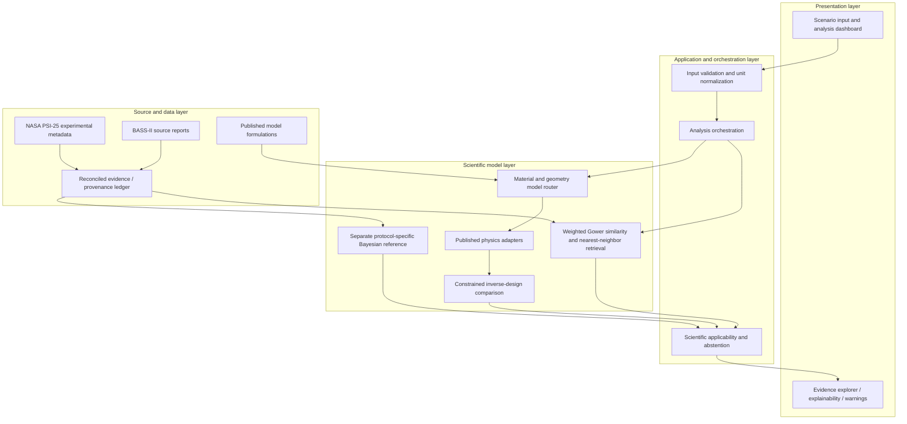

# EMBER System Architecture

The architecture separates interactive presentation, application orchestration, scientific computation and experimental provenance. It is a **formal system diagram**, not a NASA-certified hardware system.

## Request and response flow

1. **Input acquisition.** Users specify material, geometry, gravity, oxygen concentration, pressure, airflow and geometry-specific parameters.
2. **Validation and routing.** Reject unknown units and missing required variables before scientific computation. Select only the physics adapter compatible with the material/geometry pair.
3. **NASA evidence retrieval.** Rank eligible experiments using mixed-type Gower-style similarity, maintaining original experiment IDs, source provenance, missing-data flags and traceable citations.
4. **Physics computation.** Compute the selected source-supported physical fingerprint; never silently replace a missing observation with a calculated value.
5. **Inverse comparison.** When supported, minimize a mismatch between physical fingerprints under bounded parameters; a close numerical match is not general flame equivalence.
6. **Bayesian reference.** A separately scoped oxygen-only model may provide context for its original sustained-ignition protocol. Its probability is **not** automatically a prediction for an arbitrary scenario.
7. **Scientific guard.** Surface unsupported-model and no-validated-bridge states with explanation rather than invented outcomes.
8. **Output.** Distinguish measured NASA conditions, derived physics values, Bayesian context, provenance and model limitations.

## Trust boundaries

| Transfer | Guaranteed meaning | Not guaranteed |
| --- | --- | --- |
| Original NASA source → normalized ledger | A traceable reported source value | Independent scientific validation of every data field |
| Evidence ledger → Gower ranking | Relevance based on compared attributes | Probability, flame-spread outcome, physical equivalence |
| Physical inputs → model fingerprint | Computed quantity under model assumptions | Generalized fire-safety prediction |
| Fingerprint → inverse comparison | Numerical match of the selected quantity | Equivalent flames in different gravity |
| Bayesian reference → explanation | Statistical inference within calibration protocol | Valid extrapolation to other materials, planets or geometries |

**Output requirements:** source IDs, input values and units, applicability state, model identifier, observed-versus-derived labeling, numerical residual where available, limitations and explicit abstention if unsupported.

The complete current Vercel source is not represented by this diagram; this is a logical architecture reconstructed from the source-linked methods and earlier research packages.
